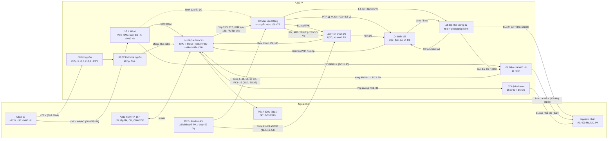

# PHÂN TÍCH TOÀN KHỐI & HƯỚNG SỬA CHỮA

# A313-V

**Rev. A — 20/10/2026.** Thực hiện việc §4.8 của `CLAUDE.md`. Tài liệu dẫn xuất, không thay
thế hồ sơ gốc A32. Tấm .06 đã có phân tích riêng (`PHAN-TICH_A313-V.06_KHUECH-DAI-TIN-HIEU-RA.md`,
Rev. C) — ở đây chỉ tóm tắt và nối vào toàn khối.

**Rev. A1 (cùng ngày):** bổ sung hai điểm đối chiếu với khối gốc A-313-3 ([A3] §2.2.2, trang PDF
45 và 49): tầng chuyển mạch K nằm trên tấm tích phân (§3.3, §6 U21) và tín hiệu điều chế
`УПР. МОД 1/2` lấy từ 5 V 400 Hz pha AC (§2.5, §6 U1).

> ⚠ Mọi kết luận "cấp linh kiện" lấy từ **SchDoc vẽ lại** đều là ứng viên. Chỗ nào đã đối chiếu
> được với BVTK/TMKT thì ghi ✅; chỗ chỉ có một nguồn ghi ◐; chỗ các nguồn mâu thuẫn ghi ⚠ và có
> mặt trong bảng §6. Trước khi hàn/thay linh kiện theo bảng này, đo nguội xác nhận trên tấm thật.

---

## 0. NGUỒN, PHƯƠNG PHÁP, ĐỘ TIN CẬY

### 0.1. Nguồn đã dùng

| Ký hiệu      | Tài liệu                                                               | Dùng cho                                                                                                                   |
| -------------- | ------------------------------------------------------------------------ | --------------------------------------------------------------------------------------------------------------------------- |
| [TMKT]         | `TMKT&HDSD A313-V/TMKT&HDSD A313-V.pdf` (57 tr.)                       | Nguyên lý từng cụm (§6.1–6.10), bảng hỏng hóc (Phần 2 §4), **phụ lục đầu cắm 3Ш3/3Ш4** (tr. 51–57) |
| [GA]           | `GIAO AN HLKT A313-V.pdf`                                              | Bảng điểm đo nguồn thứ cấp, các bước khắc phục từng kênh                                                      |
| [HDSD]         | `3.HDSD A313-V/HDSD-A313-V_HS dau A.pdf`                               | §3.2.4 tín hiệu vào/ra ngoại vi                                                                                        |
| [BV.xx]        | `1.BVTK A313-V/BVTK-A313-V_HS dau A.pdf` — trang = BV + 4             | Sơ đồ chức năng BV.01, bảng linh kiện BV.05/09/13/17/21/29/33/37, BV.38 (.09), BV.42 (.10)                           |
| [SCH]          | `File mach in va mach nguyen ly_A313_V/*/*.SchDoc` (14 file)           | BOM và **netlist hình học** từng tấm                                                                             |
| [A1]/[A2]/[A3] | `A313 original/A-313-1ok.pdf`, `A-313-2.pdf`, `A-313-3.HDSDKT.pdf` | Hệ tự kiểm (Bảng 12), **cây tìm hỏng hóc Hình 101–111**, khối vào-ra gốc A-313-3                         |

### 0.2. Script (thư mục `tmp/pdfs/review/toan-khoi/`) — chạy từ gốc repo, theo thứ tự

| Script               | Làm gì                                                                                                                            | Đầu ra                                                                    | Tự kiểm                                                        |
| -------------------- | ----------------------------------------------------------------------------------------------------------------------------------- | --------------------------------------------------------------------------- | ---------------------------------------------------------------- |
| `tk_schdoc.py`     | Đọc 14 SchDoc bằng `olefile`, dựng BOM + netlist (union-find trên dây, chân, nhãn, junction)                              | `schdoc_bom.csv`, `schdoc_nets.csv`, `schdoc_summary.json`            | hướng chân, điểm-trên-đoạn; hàm `crosscheck` (§0.3)  |
| `tk_connectors.py` | Tách phụ lục 3Ш3/3Ш3B/3Ш4/3Ш4B của [TMKT] (pdfplumber) và **đối chiếu** với nhãn net SchDoc tại cùng chân DC | `tmkt_3Sh_pinout.csv`, `tmkt_vs_schdoc.csv`, `connector_summary.json` | đủ 67 chân × 4 nửa đầu cắm; 4 dòng đọc bằng mắt     |
| `tk_interboard.py` | Suy tín hiệu liên tấm: cùng tên net xuất hiện ở chân DC của ≥ 2 tấm                                                    | `interboard_signals.csv`, `interboard_matrix.json`                      | —                                                               |
| `tk_mux_tree.py`   | Truy cây mux 168КТ2 (cặp исток–сток) của .02 và .05, tính tỷ số bộ chia vào                                    | `mux_tree_02.csv`, `mux_tree_05.csv`                                    | 48 đầu vào × 3 tầng; 48 ô nhớ × 3 tầng + đường đọc |
| `tk_codes.py`      | Giải mã từ tự kiểm `ОЗУ 367₈`, từ góc/tuyến tính; **mọi phép tính số** trong tài liệu                    | `numbers.json`                                                            | assert từng con số                                             |
| `tk_render.py`     | Render các ảnh bằng chứng (BV.01, BV.06, BV.38, BV.42, Bảng 12 [A1])                                                           | `*.png`                                                                   | kích thước file                                               |

### 0.3. Kiểm chéo đã làm (nền cho độ tin cậy của SchDoc)

| Phép kiểm                                         | Kết quả                                                                                                                                                                                                                                                                                                       | Nguồn                    |
| --------------------------------------------------- | --------------------------------------------------------------------------------------------------------------------------------------------------------------------------------------------------------------------------------------------------------------------------------------------------------------- | ------------------------- |
| Phụ lục [TMKT] ↔ chân DC trong SchDoc           | **225/225** dòng rơi vào chân DC có net **mang tên**; **214/225** tên khớp sau chuẩn hoá font. 11 dòng còn lại là khác cách viết (`Упр. t1` ↔ `upr. tk1`; `СВК1-ЦИ` ↔ `xvc xi1`; viết tắt `Признак`) — **không dòng nào lệch chân** | `tmkt_vs_schdoc.csv`    |
| Số vỏ tấm .06 trong SchDoc                       | 15 × 168КТ2, 18 × 140УД1Б, 16 × 2Т312Б, 16 × 2Т203Б; chân 11 của 168КТ2 cô lập — trùng kết luận Rev. C                                                                                                                                                                                   | `schdoc_summary.json`   |
| Số linh kiện tấm .05                             | 57 × 168КТ2Б, 58 × 330 kΩ, 48 + 1 tụ 4,7 µF — trùng `CLAUDE.md` §4.7 và BV.21                                                                                                                                                                                                                     | `schdoc_bom.csv`, BV.21 |
| Bảng điểm đo nguồn [GA] ↔ netlist tấm nguồn | 7/7 điểm đúng chân module; module từng vị trí = BV.33                                                                                                                                                                                                                                                   | §2.5                     |
| Mẫu chân nguồn backplane                         | 5 tấm .02, .03, .04, .05, .06 theo cùng một mẫu                                                                                                                                                                                                                                                             | §2.2                     |
| Điện trở số .03/.04 [TMKT] ↔ SchDoc            | U27/U29/U31/U32 (.03) và U34–U39, U46–U51 (.04) đúng như TMKT                                                                                                                                                                                                                                             | §3.3, §3.4              |
| Nhóm 4 kênh lệnh đơn [TMKT] ↔ cây mux .02    | U8/U9/U20/U21 (4 kênh), U3/U15 (8 kênh), U2/U14 (16 kênh) đúng                                                                                                                                                                                                                                             | §4.3.1                   |

Các dòng "số vỏ", "điểm đo nguồn", "mẫu chân nguồn" là assert trong `tk_schdoc.py` (hàm
`crosscheck`); dòng đầu là `tk_connectors.py`; hai dòng cuối là đầu ra `tk_mux_tree.py` và
`schdoc_nets.csv` đối chiếu với văn bản TMKT.

**Giới hạn:** không có SchDoc của tấm trung gian .09; BV.38 vẽ nhãn bằng nét vector, không có
lớp text, không OCR được trên máy cloud ⇒ liên kết giữa các tấm chỉ suy ra từ **tên net trùng**,
chưa có netlist backplane. Bus (`RECORD 26/37`) không được dò.

---

## 1. TỔNG QUAN KHỐI

A313-V thay thế bộ đôi Nga **A-313-2A** (bộ xử lý) + **A-313-3** (thiết bị vào-ra và nguồn).
Phần mềm dẫn đường và hệ tự kiểm được giữ "tương đương" ([TMKT] Bảng 2, mục 8) ⇒ các mã thử
`T777000` và cây tìm hỏng hóc của [A2] vẫn là điểm xuất phát (giả thiết ◐, xem §6 mục U14).

### 1.1. Thành phần và tương đương với khối gốc

| A313-V           | Tên                                                                        | Đầu cắm                                                                              | Tương đương A-313                                                                                                                                                                              | Ghi chú                                                                                            |
| ---------------- | --------------------------------------------------------------------------- | --------------------------------------------------------------------------------------- | --------------------------------------------------------------------------------------------------------------------------------------------------------------------------------------------------- | --------------------------------------------------------------------------------------------------- |
| **.01**    | Cụm điều khiển và xử lý trung tâm                                   | DC1, DC2                                                                                | A-313-2A **+** Y1…Y6 của A-313-3 (bộ tạo ПК và bus chính, bộ biến đổi tín hiệu số, các bộ điều khiển chương trình/giao tiếp/biến đổi/lệnh); Y7 tấm phối hợp ◐ | Chức năng nằm trong FPGA EP1C12 ✅ [TMKT §6.1]                                                  |
| **.02**    | Cụm chuyển mạch tín hiệu vào                                          | DC3, DC4                                                                                | Y12, Y13 (bộ chuyển mạch cửa vào) + phần chuẩn hoá của A-313-7                                                                                                                             | ◐ theo chức năng; **còn là trạm chuyển mức TTL → −23/+3,5 V cho cả khối** (§3.2) |
| **.03**    | Cụm tích phân                                                            | DC5, DC6                                                                                | Y9                                                                                                                                                                                                  | ✅                                                                                                  |
| **.04**    | Cụm biến đổi                                                            | DC7, DC8                                                                                | Y8                                                                                                                                                                                                  | ✅                                                                                                  |
| **.05**    | Cụm chuyển mạch tín hiệu ra                                            | DC9, DC10                                                                               | Y11 (У11)                                                                                                                                                                                          | ✅ [TMKT §6.4]                                                                                     |
| **.06**    | Cụm khuếch đại tín hiệu ra                                            | DC11, DC12                                                                              | Y10 (các bộ khuếch đại cửa ra)                                                                                                                                                                | ◐ theo chức năng                                                                                 |
| **.07**    | Cụm chuyển lệnh đơn ra                                                 | DC13 (mô-đun riêng, phía sau)                                                       | Y14, Y15 (bộ biến đổi PK I, II)                                                                                                                                                                 | ✅ [TMKT §6.6]                                                                                     |
| **.08.01** | Tấm nguồn điện                                                          | DC14 (mô-đun riêng, phía trước)                                                   | Y17…Y23 (7 bộ nguồn)                                                                                                                                                                             | ✅                                                                                                  |
| **.08.02** | Tấm kiểm tra nguồn                                                       | DC14                                                                                    | Y24 (tấm kiểm tra và báo hiệu)                                                                                                                                                                 | ✅                                                                                                  |
| **.09**    | Tấm mạch trung gian (backplane)                                           | 12 × DC96C (DC1…DC12)                                                                 | Y16 (tấm chuyển mạch)                                                                                                                                                                            | ◐                                                                                                  |
| **.10**    | Tấm linh kiện rời rạc                                                   | DC15 (header 14 chân)                                                                  | —                                                                                                                                                                                                  | VCC RAM, tụ lọc 27 V                                                                              |
| sát-xi          | biến thế ~36 V → ~5 V/400 Hz, cầu chì Пр1 (10 A) và 4 A, đèn 27 V | 3Ш3/3Ш3B, 3Ш4/3Ш4B (РПКМ3-67/67Ш1, phía sau), 3Ш1 (phía trước, PS17-320V) | —                                                                                                                                                                                                  | **biến thế không có trong bản vẽ nào** (§2.5)                                         |

### 1.2. Thông số khai thác ([TMKT] Bảng 2)

| Hạng mục         | Giá trị                                                                                                                                                                                                                                                                                                  |
| ------------------ | ---------------------------------------------------------------------------------------------------------------------------------------------------------------------------------------------------------------------------------------------------------------------------------------------------------- |
| Vào tương tự   | 11 kênh СКТ sin/cos ~400 Hz + 4 kênh truyền cảm điện áp tương đối = **15 kênh ngoài**; kênh **12a/12б là chuẩn nội** — `tmkt_3Sh_pinout.csv` có đúng 30 chân "Вход na/б": kênh 1…11, 13…15 trên 3Ш3, kênh 16 trên 3Ш3B, **không có kênh 12** |
| Vào lệnh đơn   | 16 × +27 V/hở (PK1…PK16, 3Ш3 → .02) + 8 × TTL (7 × `Вход nРК ТТЛ` 3Ш4B/55–61 và `Вх. Пр. П` 3Ш4/62 → .01)                                                                                                                                                                    |
| Vào/ra nối tiếp | ПК1, ПК2 (vào), ПК1-1/1-2/2-1/2-2, ПКци, ПКМ… (ra), từ mã 20 bit, đồng bộ СИ 40 kHz, 80 kHz                                                                                                                                                                                          |
| Ra tương tự     | 8 kênh a/б ~4 V/400 Hz (qua .06), 8 kênh a/б ±4 V DC (qua .05), 16 kênh tuyến tính 4 V DC (Выход 17a…32a) + Выход "б" chung                                                                                                                                                            |
| Ra lệnh đơn     | 16 × +27 V/hở (rơ-le) + 16 × colector hở                                                                                                                                                                                                                                                              |
| Nguồn             | +27 V ≤ 11 A; ~36 V/400 Hz ≤ 0,7 A                                                                                                                                                                                                                                                                       |
| Chu kỳ            | КЦ = 0,15 s phục vụ 32 thuê bao ⇒ СКЦ = 0,15 s/32 = **4,6875 ms** (TMKT in nhầm "4,7 s"); ОЦ = 32 × КЦ = **4,8 s** (`numbers.json: cycle`)                                                                                                                                    |

---

## 2. SƠ ĐỒ KHỐI TOÀN KHỐI

### 2.1. Sơ đồ khối (dựng từ BV.01 + phụ lục [TMKT] + `interboard_signals.csv`)



### 2.2. Đầu cắm

**Backplane .09:** 6 cặp DC96C (3 hàng A/B/C × 32): DC1-DC2 → .01, DC3-DC4 → .02, … DC11-DC12 →
.06 ([TMKT §4]). Chân nguồn **chuẩn cho mọi tấm 96 chân** (SchDoc .02 đến .06 đều theo, assert trong `tk_schdoc.py`):

| Đầu cắm                                | A1, B1, C1, A31…C32 | A2–C2           | A3–C3             | A4–C4            | A5–C5                           |
| ----------------------------------------- | -------------------- | ---------------- | ------------------ | ----------------- | -------------------------------- |
| DC **lẻ** (DC1, 3, 5, 7, 9, 11)    | GND                  | **+5 V**   | **+3,5 V**   | **+6,3 V**  | (.05: −6,3 V; .06: ~5 V/400 Hz) |
| DC **chẵn** (DC2, 4, 6, 8, 10, 12) | GND                  | **−23 V** | **−12,6 V** | **+12,6 V** | —                               |

.01 chỉ lấy +5 V (DC1/DC2 A2–C2) và **VCC RAM** (DC2 A30–C30). Tấm có thể bỏ trống chân rail
không dùng: .02 không nối ±12,6 V (DC4 A3/A4); .06 nhận nhưng không dùng +5 V/+6,3 V (Rev. C §9.6).
Đồ gá cấp tấm cho .02 đến .06 dùng chung một khung nguồn theo bảng này (nhớ: tấm .06 không có bảo
vệ ngược cực, `README.md` §2).

**Đầu cắm ngoài** (`connector_summary.json`, 67 chân mỗi nửa):

| Nửa đầu cắm | Đi tới                                                            | Nội dung chính                                                                                                                                                                                                                                                                                                                       |
| --------------- | ------------------------------------------------------------------- | -------------------------------------------------------------------------------------------------------------------------------------------------------------------------------------------------------------------------------------------------------------------------------------------------------------------------------------- |
| **3Ш3**  | .02 (57), .03 (9), sát-xi (1)                                      | Вход 1…11, 13…15 a/б; PK1…16 (+27 V); Вход К1…К3 a/б/PK (→ .03); Упр. t1…t4, T1…T4 (ra ngoài); Подкл. 1/2                                                                                                                                                                                                  |
| **3Ш3B** | .05 (33), .06 (18), sát-xi (5), .02 (2), .03/.04 (1+1), trống (6) | Выход 1a…8б ≈ (400 Hz, từ .06); Выход 9a…16б, 17a…32a = (DC, từ .05); **Вход 16a/б** (→ .02); **Uоп ~5В (chân 55)**, **Uоп =4В (chân 57)**; Упр мод 1/2; các rail ±12, +6,3, +3,5, −23 V                                                                                    |
| **3Ш4**  | .07 (34), .01 (4), DC14 (3), sát-xi, trống (11)                   | Выход РК1…32; **+27 V БС** qua Пр1 10 A (chân 35, 54, 58, 60, 63, 64); **~36 V 400 Гц ФА (55) → chân 1 biến thế, ФС (56) → cầu chì 4 A → chân 4 biến thế**; ВКЛ/Испр Питания/Откл (47/49/51 → DC14); **Испр ТТЛ (48, từ .01 DC2.B29)**; Вх. Пр. П (62) |
| **3Ш4B** | .01 (62), trống (5)                                                | Вход ПК1/ПК2 (16+16), ra ПК1-1…ПК2-2, СИ, СВК, СПК, 80 кГц, ПКМ/БК/ЦИ; 7 lệnh TTL vào; 7р…10р АЦИ                                                                                                                                                                                               |

### 2.3. Luồng tín hiệu

| Luồng                                | Đường đi                                                                                                                                                                                                                                                                                                                    | Điều khiển                                                                                                                                        |
| ------------------------------------- | ------------------------------------------------------------------------------------------------------------------------------------------------------------------------------------------------------------------------------------------------------------------------------------------------------------------------------- | ---------------------------------------------------------------------------------------------------------------------------------------------------- |
| **Mã hoá tương tự** (A→D) | 3Ш3 → **.02** bộ chia 2:1 → mux L1 (t) → L2 (T) → L3 → `Вых a/б` → **.03** chọn nguồn (К1…К4) → lặp/đảo/tích phân trong một chu kỳ 400 Hz → `Инт a/б` → **.04** U27 so sánh + điện trở số → bit `РПР` trong FPGA (.01) → từ 18 bit vào `ОЗУ 000…037₈` | `Упр АП/НУ/ИНТ`, `РМ 8р–15р` (cân bằng hằng số thời gian, mã ở `ОЗУ 227₈`), đồng bộ pha bằng xung 400 Hz từ .06 |
| **Giải mã** (D→A)            | `ОЗУ 040…077₈` → FPGA → `РПР 4р–15р` → **.02** chuyển mức → **.04** điện trở số 1/2 → `A пр/B пр` → **.05** phân kênh 1→32 (К→T→t) ghi tụ nhớ; đọc lại `ОС a/б` về .04 khép vòng → ra DC; 8 kênh a/б → **.06** điều chế 400 Hz               | cập nhật mỗi 0,15 s ([TMKT §6.4])                                                                                                                |
| **Lệnh đơn vào +27 V**      | 3Ш3 → **.02** R 18 kΩ + kẹp 2Д908А (U12, U24) → mux (U8/U9/U20/U21 → U3/U15 → U2/U14) → `Вых PK` → **.03** so sánh (T1) → `Вых. Комп. РК` → .01 → bit 15 của `ОЗУ 000…037₈`                                                                                                  | cùng T/t với kênh tương tự                                                                                                                     |
| **Lệnh đơn vào TTL**        | 3Ш4B/55–61 → .01 trực tiếp                                                                                                                                                                                                                                                                                                 | —                                                                                                                                                   |
| **Lệnh đơn ra**              | `ОЗУ 225₈/226₈` → FPGA → 74HC374 (U11/U15/U13/U17) → DC2 → **.07** (rơ-le +27 V / colector hở) → DC13 → 3Ш4                                                                                                                                                                                               | —                                                                                                                                                   |
| **Nối tiếp**                  | 3Ш4B ↔ .01 (FPGA, đệm CT25244 U19/U20); thu vào `ОЗУ 100…137₈`, phát từ `140…177₈`                                                                                                                                                                                                                            | СИ 40 kHz, 80 kHz, СВК, СПК do .01 phát (chủ động)                                                                                       |
| **Chuẩn 400 Hz**               | 3Ш4/55–56 ~36 V → biến thế sát-xi → ~5 V/400 Hz → .06 (DC11.A5) → tạo `xung400Hz` (DC11.A6 → .01 DC1.A9 "400 Гц") và М/М̄                                                                                                                                                                                    | §2.5                                                                                                                                                |
| **Báo nguồn tốt**            | .08.02 → `Испр. пит. ЦВУ` → .01 DC2.A3 → LM393 U7 (ngưỡng 1,5 V/3,5 V) → cho phép CE của RAM                                                                                                                                                                                                                | [TMKT §6.1]                                                                                                                                         |
| **Báo máy tốt**              | phần mềm: bit 5 `РгК2` dạng mêan → .01 U43…U46 → `Испр. ТТЛ` (3Ш4/48) / `Испр. Ключ` → đèn ОТКАЗ                                                                                                                                                                                        | §4.1                                                                                                                                                |

### 2.4. Tín hiệu liên tấm suy từ SchDoc (`interboard_signals.csv`)

88 tên trùng ở chân DC của ≥ 2 tấm, trong đó 9 là nguồn/mát. Số tên tín hiệu chung theo cặp
(`interboard_matrix.json`): .01↔.02 = 41 · .05↔.06 = 16 · .02↔.03 = 12 · .02↔.05 = 11 ·
.01↔.03 = 9 · .03↔.04 = 4 · .03↔.05 = 4 · .04↔.05 = 4 · .01↔.04 = 1 · .02↔.04 = 1 · .01↔.10 = 1 · .08.02↔.10 = 1.

| Nhóm                                | Tên (SchDoc → đọc là)                                                                                                                        | Từ → tới                                                                           |
| ------------------------------------ | ------------------------------------------------------------------------------------------------------------------------------------------------- | ------------------------------------------------------------------------------------- |
| Chọn kênh TTL                      | `upr t1…t4 ttl` (`Упр T1…T4 ТТЛ`), `upr te1…te4 ttl` (`Упр t1…t4 ТТЛ`), `c1…c4` (`К1…К4`), `podcl 1/2 ttl`      | .01 → .02                                                                            |
| Chọn kênh đã chuyển mức        | `upr. t1…t4` (= **T**, tầng L2), `upr. tk1…tk4` (= **t**, tầng L1), `upr. c1…c4` (= **К**)                          | .02 → .05; К cả → .03                                                             |
| Mã thang tích phân                | `upr 8r…15r rm` (`Упр 8р…15р РМ`)                                                                                                    | .01 → .02 → .03                                                                     |
| Mã biến đổi                      | `upr 4r…15r rpr` (`Упр 4р…15р РПР`)                                                                                                 | .01 → .02 (→ .04 dưới tên `4p…15p`, khớp theo chức năng, không theo tên) |
| Điều khiển chế độ              | `upr d/f/pp/kn1/kn2/c/vih`, `ap_nu`, `int_nu`, `contr cod`, `knac`                                                                      | .01 → .02 (→ .03/.04)                                                               |
| Tích phân → biến đổi           | `int.a`, `int.b`                                                                                                                              | .03 → .04                                                                            |
| Biến đổi ↔ bộ nhớ              | `a pr`, `b pr` (→ .05); `OC"a"`, `OC"b"` (← .05)                                                                                        | .04 ↔ .05                                                                            |
| Bộ nhớ → khuếch đại            | `vih.1a=` … `vih.8b=`                                                                                                                        | .05 → .06                                                                            |
| Khác                                | `ip` (.01↔.03), `VCC RAM` (.01↔.10), `Выход б` (.02↔.05)                                                                           |                                                                                       |
| Không khớp được tên, ghép tay | `xung400Hz` .06 DC11.A6 ↔ `400gj` (= 400 Гц) .01 DC1B.A9; `compar contr`/`compar rpr` .04 DC7.A6/B5 ↔ `comp contr`/`comp rpr` .01 | cần đo thông mạch (§5)                                                           |

### 2.5. Nguồn và chuẩn 400 Hz

**Rail thứ cấp** — module, chân đo trên tấm nguồn và chân ra DC14C (`schdoc_nets.csv`,
.08.01); bảng điểm đo của [GA] khớp 7/7:

| Rail      | Module (BV.33 = SchDoc) | Chân đo [GA] | DC14C          | LED                      |
| --------- | ----------------------- | -------------- | -------------- | ------------------------ |
| +5 V      | U6 TEN40-2411N          | U6.4           | 1A, 1B, 2A, 2B | D1…D8 (8 LED báo rail) |
| +6,3 V    | U1 PTN78020W            | U1.5, U1.6     | 3A, 3B, 4A     |                          |
| −6,3 V   | U2 PTN78020A (+ L2)     | U2.1           | 10B, 11A, 11B  |                          |
| +12,6 V   | U5 THN30-2422           | U5.3           | 4B, 5A, 5B     |                          |
| −12,6 V  | U5 THN30-2422           | U5.5           | 9A, 9B, 10A    |                          |
| +3,5 V    | U3 PTN78020W            | U3.6           | 7B, 8A, 8B     |                          |
| −23 V    | U4 THN30-2415           | U4.5           | 12A, 12B, 13A  |                          |
| 27 V vào | —                      | —             | 6A, 6B, 7A     |                          |

⚠ [TMKT §6.7] ghi khác (U3 = PTN04050A cho −6,3 V lấy từ +5 V; U5 = TEN40-2411; U6 = TEN25-2422).
BV.33, SchDoc và [GA] thống nhất với nhau ⇒ dùng bảng trên, coi TMKT §6.7 là mô tả phương án cũ
(§6 mục U4). Trên .09 có cụm **điểm đo nguồn** cho GND và đủ 7 rail (BV.38, `bv38_diem-do-nguon.png`).

**Chuẩn ~5 V/400 Hz — trả lời một phần câu hỏi mở `CLAUDE.md` §4.6:**

* BV.01 (`bv01_so-do-chuc-nang.png`): A313-12 → `36V/400Hz` → 3Ш3/3Ш4 → **A313-V.10** → `5V\400Hz` → **A313-V.06**.
* Phụ lục [TMKT]: 3Ш4/55 `~36B 400Гц ФА` → **chân 1 biến thế**; 3Ш4/56 `~36B 400Гц ФC` → **cầu chì 4 A → chân 4 biến thế**.
* [TMKT §4]: "biến thế 5V/400Hz được bố trí rời rạc trên phần Sát xi"; §6.5: "Tần số 400 Hz vào được lấy từ biến thế Tp1".
* BV.42 (`bv42_tam-linh-kien-roi.png`) và SchDoc .10 **không** có biến thế; không trang BVTK nào có `Tp1`.

⇒ Nguồn gốc **có căn cứ tài liệu**: biến thế hạ áp trên sát-xi, sơ cấp nối **dây pha A–pha C**
của lưới ~36 V/400 Hz, thứ cấp cấp DC11.A5 của .06. Vì sơ cấp là điện áp lưới ghi theo quy ước
`~36 В` (rms), `~5 В` nhiều khả năng cũng là rms — **ủng hộ** kết luận 5 V<sub>rms</sub> của
Rev. C nhưng **chưa thay được phép đo** Δt(М, xung400Hz). Ngoài ra 3Ш3B/55 `Uоп ~5В` đi ra
ngoài và kênh vào 12a/12б (chuẩn 45° của A-313-3: "các cửa vào 12a và 12б có điện áp chuẩn
5 V 400 Hz", [A3] §2.3) có trên .02 (DC3.A14, DC3.B15) nhưng không có trên 3Ш3 ⇒ rất có thể cũng
lấy từ biến thế này (◐ — cần đo thông mạch, §5 việc H2).

**Đối chiếu khối gốc A-313-3** ([A3] §2.2.2, trang PDF 49): các bộ khuếch đại cửa ra (Y10, tương
đương .06) "điều chế tín hiệu bằng tần số 400 Hz **của pha AC**" và "các tín hiệu điều khiển
`УПР. МОД. 1`, `УПР. МОД 2` được tạo ra từ **điện áp 5 V 400 Hz**" ⇒ trong khối gốc, chuẩn
5 V 400 Hz cũng lấy từ lưới 36 V giữa pha A và pha C — **cùng sơ cấp** với biến thế của A313-V
(3Ш4/55–56). Đây là thêm một căn cứ cho kết luận ở trên, vẫn không thay phép đo H2. Trong A313-V,
3Ш3B/50–51 còn mang tên `Упр мод 1`/`Упр мод 2` nhưng phụ lục để trống đích (`tmkt_3Sh_pinout.csv`,
assert trong `tk_connectors.py`), còn .06 tự tạo М/М̄ từ DC11.A5 ⇒ hai chân này có thể chỉ là di sản
bảng chân A-313 (◐, kiểm thông mạch khi làm H11).

---

## 3. TỪNG TẤM

Ký hiệu trong bảng "điểm đo": `DCn.Xk` = chân trên đầu cắm của tấm; `Ux.p` = chân IC. Tên tín
hiệu ghi theo [TMKT]; trong ngoặc là nhãn SchDoc khi khác.

### 3.1. A313-V.01 — Điều khiển và xử lý trung tâm (DC1, DC2)

**Chức năng.** Toàn bộ A-313-2A và phần điều khiển của A-313-3 nằm trong FPGA **EP1C12Q240I7 (U10)**:
bộ xử lý 1 địa chỉ, ROM A313-22V, điều khiển bộ nhớ A313-23V, bộ điều khiển chương trình/giao
tiếp/biến đổi/lệnh, bộ tạo mã nối tiếp ([TMKT §6.1]). Bộ nhớ A313-23V gồm RAM **CY62256N** U33
(bit 0–7), U34 (8–15), U35 (bit kiểm 16–17), dùng 1024 từ; ППЗУ **CY14B101K** (nvSRAM) U36…U38,
dùng 128 từ, AutoStore qua tụ VCAP C8/C10/C12, RECALL khi cấp nguồn (20 ms). RAM giữ 10 s nhờ
**VCC RAM** từ .10; chân CE bị khoá khi `Испр. пит. ЦВУ` xấu (LM393 U7 so 1,5 V / 3,5 V → NAND U39A).

**Linh kiện chính** (SchDoc = BV.05 trừ chỗ ⚠): U10 EP1C12Q240; U3 **EPCS16** (cấu hình, J1 AS);
J2 JTAG; dao động U1 64 MHz, U2 4 MHz, U42 13 MHz (⚠ BV.05 ghi cả ba là 64 MHz); U4, U5 TLV1117,
U6 TPS70248 (1,5 V/3,3 V cho U10, 3,3 V cho U36–U38); đệm ra:

| IC                    | Loại                        | Tín hiệu ra (`schdoc_nets.csv`)                                                                          |
| --------------------- | ---------------------------- | ------------------------------------------------------------------------------------------------------------ |
| U11 / U15 / U13 / U17 | 74HC374                      | `Упр выход РК1–8` / `РК9–16` / `РК17–24` / `РК25–32` → .07                      |
| U19                   | CT25244                      | СИ, СИ М, СИ БК, СИ ЦИ, 80 кГц, СПК1, СВК1, СВК2                                    |
| U20                   | CT25244                      | ПК1/ПК2/ПК3 ra, СПК2, СПКМ, СВК БК, СВК СИ1/2                                         |
| U21                   | CT25244                      | ПК4, ПК ЦИ, ПК вх К3А, `Упр T1–T4 ТТЛ`, `Упр t1 ТТЛ`                            |
| U22                   | CT25244                      | `Подкл 1/2 ТТЛ`, `Упр t2–t4 ТТЛ`                                                          |
| U23                   | CT25244                      | `К1–К4`, знак, АП НУ, ИНТ НУ, контр код                                            |
| U24                   | CT25244                      | `Упр 8р–15р РМ`                                                                                    |
| U25 / U26 / U27       | CT25244                      | `Упр К, Д, Ф, ПП, Кн1, Кн2, Вых, 4р РПР` / `5р–12р РПР` / `13р–15р РПР` |
| U43…U46              | 133ЛА8, 133ЛН1, 1НТ251 | `Исправн. ТТЛ` (DC2.B29 → 3Ш4/48), `Исправн. Ключ` (DC2.C29)                      |

⚠ BV.05 còn liệt kê **U28…U32 = SN74CB3T3245** (đệm vào, khớp "IC 3245" ở [TMKT] Phần 2 §4) mà
SchDoc không có (vào qua R32…R77 thẳng U10, [TMKT §6.1]) ⇒ hai phiên bản phần cứng (§6 mục U7).

**Triệu chứng hỏng điển hình.** Đèn ОТКАЗ + mã thử có cờ ЦВУ/ОЗУ/ППЗУ/БЗ (§4.1); mất chương trình
bay/tọa độ sau tắt nguồn (U36–U38, tụ VCAP, chuỗi VCC RAM); một nhóm 8 lệnh đơn ra chết (một
74HC374); một kênh nối tiếp ra chết (U19/U20); toàn bộ mã hoá hoặc giải mã sai trong khi .02–.05
tốt (U21–U27 hoặc logic biến đổi trong FPGA); không khởi động (cấu hình EPCS16, dao động, nguồn 1,5/3,3 V).

**Điểm đo.** DC1/DC2 A2–C2 (+5 V); DC2 A30–C30 (VCC RAM); DC2.A3 `Испр. пит. ЦВУ` (vào);
DC2.B29/C29 (`Испр. ТТЛ`/`Ключ`); DC1.A9 (400 Гц từ .06); dao động U1/U2/U42; CONF_DONE trên J1;
chuỗi JTAG J2 (IEEE 1149.1: đọc IDCODE, sau đó boundary-scan các chân U10 → đệm); ngõ ra
U11/U13/U15/U17 (theo `ОЗУ 225₈/226₈`).

### 3.2. A313-V.02 — Chuyển mạch tín hiệu vào (DC3, DC4)

**Chức năng.** Mux 16 vị trí × 3 rãnh (a, б, PK) ⇒ 48 đầu vào; bộ chia vào; **chuyển mức TTL →
−23 V/+3,5 V** cho chính nó và cho .03, .05 (168КТ2 mở ở −23 V, đóng ở +3,5 V, [TMKT §6.2]).
Cây mux (`mux_tree_02.csv`, cả 48 đầu vào đều qua đúng 3 tầng):

| Tầng                   | Cổng điều khiển                                   | IC (168КТ2Б)                                                                                                                           |
| ----------------------- | ----------------------------------------------------- | ----------------------------------------------------------------------------------------------------------------------------------------- |
| L1 (4 → 1 trong nhóm) | `Упр. t1…t4` (SchDoc `upr. tk1…4`)           | tương tự a: U4 (1–4), U6 (5–8), U16 (9–12), U18 (13–16); б: U5, U7, U17, U19; PK: U8 (1–4), U9 (5–8), U20 (9–12), U21 (13–16) |
| L2 (chọn nhóm)        | `Упр. T1…T4` (SchDoc `upr. t1…4`)            | U1 (a/б kênh 1–8), U13 (a/б 9–16), U3 (PK1–8), U15 (PK9–16)                                                                        |
| L3                      | ⚠ SchDoc nối cổng vào net `−23V/contr cod ttl` | U2 (kênh 1–8 cả a/б/PK), U14 (kênh 9–16)                                                                                            |

Khối gốc chỉ có ba tầng t → T → K, và **tầng K nằm trên tấm tích phân** ([A3] §2.2.2, trang PDF 45),
tương ứng U4/U5/U6 của .03 (§3.3). Vì vậy U2/U14 trên .02 là một tầng thêm so với khối gốc. Nếu cổng
của nó nối cứng −23 V (luôn đóng) như SchDoc vẽ thì đó có thể là chủ ý thiết kế, nhưng nhãn
`contr cod ttl` trên cùng net vẫn phải kiểm (◐, §5 H3, H10).

**Bộ chia vào** (tính trong `tk_mux_tree.py`): kênh thường 5 kΩ/5 kΩ ⇒ **0,5** ⇒ 8 V đỉnh vào cho
4 V tại mux (khớp "8 V" của [TMKT]/[GA]; [HDSD] ghi 12 V là chép từ A-313-7 vốn chia 3:1). Kênh
**12a: 10 kΩ/5 kΩ = 1/3; 12б: 10,15 kΩ/5 kΩ = 0,330** — kênh chuẩn nội được thiết kế riêng.
⚠ BV.09 ghi **cả 64 điện trở R16…R94 = 160 Ω**, BV.06 không in trị số. Nếu 160 Ω là đúng, mỗi
kênh tải nguồn СКТ 320 Ω (25 mA đỉnh ở 8 V) so với 10 kΩ (0,8 mA) theo SchDoc
(`numbers.json: divider_02`) ⇒ nghi BV.09 sai, phải đo.

Lệnh đơn vào: R8…R15, R55…R62 = 18 kΩ nối tiếp (BV.09 = SchDoc) + ma trận diode 2Д908А U12
(PK1–8), U24 (PK9–16). Đế (chân 11) của 168КТ2 trên .02 nối **+6,3 V** theo SchDoc (khác .06 để nổi).

**Chuyển mức** 198НТ7 (12 vỏ theo SchDoc, ⚠ BV.09 ghi 11):

| IC            | Tín hiệu                            | IC  | Tín hiệu                     |
| ------------- | ------------------------------------- | --- | ------------------------------ |
| **U65** | T1, T2, t1, t2                        | U71 | Д, ПП, РМ 14р–15р      |
| **U66** | T3, T4, t3, t4                        | U72 | К, Ф, Кн1, Кн2           |
| U67           | К1, К2, Подкл. 1, 2            | U73 | Упр Вых, РПР 4р–6р |
| U68           | знак, К3, К4, контр код | U74 | РПР 7р–10р               |
| U69           | АП НУ, ИНТ НУ, РМ 8р–9р | U75 | ДУБИ1/2 (?), РПР 15р   |
| U70           | РМ 10р–13р                       | U76 | РПР 11р–14р              |

**Triệu chứng.** Theo nhóm kênh (§4.3.1). Đặc trưng của tấm này: **hỏng cùng chỉ số kênh ở cả vào
lẫn ra** (vì T/t do U65/U66 phát cho cả .05) và **giải mã sai theo bit** (`РПР` qua U73–U76).

**Điểm đo.** Vào: DC3 (Вход na/nб, PK n — chân xem `tmkt_3Sh_pinout.csv`). Ra mux: `Выход a/б/PK`
(sang .03). Điều khiển sau chuyển mức: `Упр. T1…T4` DC3.A23/B23/C23/A24; `Упр. t1…t4`
DC3.B24/C24/A25/B25 (cũng ra 3Ш3/55–62); nguồn theo bảng §2.2.

### 3.3. A313-V.03 — Tích phân (DC5, DC6)

**Chức năng.** Hai rãnh a, б: lặp emitơ → đảo → tích phân trong một chu kỳ 400 Hz; ba chế độ
`Упр АП` (tự chỉnh), `Упр НУ` (quy không), `Упр ИНТ` (tích phân), mức −23/+3,5 V do .02 cấp.
**ЦУС** (điện trở số) U27, U29, U31, U32 do `РМ 8р–15р` (2 bit/vỏ, ✅ SchDoc = [TMKT]) chỉnh hằng
số thời gian rãnh sin để mã kênh chuẩn 12 bằng 45° (mã ghi ở `ОЗУ 227₈`, [A1] §2.5.1). Chọn nguồn
vào U4/U5/U6 theo `Упр К1…К4`: đầu ra mux .02 hoặc 3 kênh trực tiếp **К1…К3** (3Ш3/46–54). Đây
đúng là cấu trúc gốc: [A3] §2.2.2 (trang PDF 45) ghi chuyển mạch vào ba tầng do t1–t4, T1–T4,
K1–K4 điều khiển, "tầng thứ ba của bộ chuyển mạch được bố trí ở tấm mạch các bộ tích phân". Mạch
chọn chi tiết vẫn chưa dò (§6 U21). So sánh lệnh đơn: T1 → `Вых. Комп. РК` (DC5.A5; ◐ tên phía .01 chưa
khớp được, [GA] có nêu đường này).

**Linh kiện** (BV.13 = SchDoc): 10 × 140УД1Б (U33…U40, U61, U62), 25 × 168КТ2 (19 Б + 6 В),
T1–T2 2Т312Б, T3–T10 C1815, 2Д917А, 2Д102А.

**Triệu chứng.** Mã hoá **mọi** kênh tương tự lệch đều hoặc dao động (tích phân, ЦУС); `ОЗУ 227₈`
ở biên dải (ЦУС hết dải chỉnh); cả 16 lệnh đơn vào chết (T1, U6, đường `Вых. Комп. РК` — [GA]
nêu "U6A, U61, T1"); chỉ К1–К3 trực tiếp chết (U4/U5/U6).

**Điểm đo.** `Инт a` DC5.A25, `Инт б` DC5.A26 (dạng dốc tuyến tính trong khung ИНТ); `ОС a/б`
DC5.A13/A14; `Вых. Комп. РК` DC5.A5; `ИП` DC5.C5; `Упр АП+НУ` DC6.A8, `Упр ИНТ+НУ` DC6.B8, `Упр К1…К4` DC6.A6/B6/C6/A7.

### 3.4. A313-V.04 — Biến đổi (DC7, DC8)

**Chức năng** ([TMKT §6.3]). Mã hoá và giải mã tuyến tính/hàm trên cùng một bộ: so sánh **U27**
(chân 9 = 0 khi cân bằng); khuếch đại K1 **U33**; lặp U31, U41, U45, U53; đảo U42; **điện trở số 1**
R53…R70 + **U34…U39**, **điện trở số 2** R80…R97 + **U46…U51** (2 bit `РПР`/vỏ, ✅ SchDoc); chuyển
mạch bát phân U10, U28, U29 (logic `2р3р`); hiệu chỉnh `Корр` (U12, `4р`/`5р`); tự bù lệch qua
tụ nhớ C27, C31, C6, C7 trong `Д∨К`; phối hợp đặc tuyến thiên áp của bộ nhớ tương tự D8, R44;
`Uоп` từ ổn áp D1 (Д818Е theo BV.17) hoặc bộ lặp; kiểm mạch vào U44 + T1.

**Linh kiện** (BV.17): 8 × 140УД1Б (U27, U31, U33, U41, U42, U45, U53, U144 — trùng các vị trí
TMKT nêu), 168КТ2Б/В, D1 Д818Е, D8/D9 Д814А, transistor 2Т312Б, 2Т203Г, 2Т301Г và 8 × C1815.
SchDoc ghi thêm Д818А/Д818Д ở vị trí khác — đối chiếu khi thay.

**Triệu chứng.** Cả mã hoá **và** giải mã sai ⇒ .04 trước ([TMKT] Phần 2 §4 mục 7); lỗi chỉ ở một
dải góc/bát phân ⇒ U10/U28/U29 hoặc logic 2р3р; lỗi theo trọng số bit cố định ⇒ một section của
U34…U39 / U46…U51 hoặc điện trở đi kèm; trôi lệch không theo nhiệt ⇒ tụ tự bù C6/C7/C27/C31, rò
khoá 168КТ2.

**Điểm đo.** `Инт a/б` DC7.A25/A26 (vào); `A пр/B пр` DC7.A15/A16 (ra, rời rạc); `ОС a/б`
DC7.A13/A14 (hồi tiếp); `Компар контр` DC7.A6, `Компар РПР` DC7.B5 (về .01); nhãn `comp[nx Uop`
DC7.A27 (◐ đọc là `компенс. Uоп`); bit `4p…15p` trên DC8 (C13, A14, B14, C14, A15, B15, C15, A16, B16, C16, A17, B17).

### 3.5. A313-V.05 — Chuyển mạch tín hiệu ra / bộ nhớ tương tự (DC9, DC10)

**Chức năng.** 48 ô nhớ tương tự (+1, xem §6 U20): 16 a + 16 б cho kênh 1–16 và 16 a cho kênh
17–32. Ô nhớ **không phải tụ + khoá đơn thuần**: tụ 4,7 µF nằm ở **cổng** của tầng lặp nguồn
gồm hai section 168КТ2 song song (cực về −6,3 V), tải 330 kΩ lên +12,6 V — đúng "đặc tuyến vào
thiên áp" mà .04 phải bù (D8, R44). Cùng một vỏ L1 vừa ghi tụ vừa nối đầu ra về bus đọc lại
⇒ .04 so `ОС` với giá trị đặt và chỉnh `A пр/B пр` tới khi khớp (vòng kín qua tầng lặp).

Cây phân kênh (`mux_tree_05.csv`, 48/48 ô, ghi và đọc đều 3 tầng):

| Tầng      | Cổng                    | IC                                                                                                    |
| ---------- | ------------------------ | ----------------------------------------------------------------------------------------------------- |
| L3         | `Упр К1` / `К2` | U15 (rãnh a: kênh 1–16 qua K1, 17–32 qua K2; ghi 3-1/12-14, đọc 5-7/10-8), U16 (rãnh б 1–16) |
| L2         | `Упр T1…T4`        | U9 (1–8a), U10 (9–16a), U11 (17–24a), U12 (25–32a), U13 (1–8б), U14 (9–16б)                   |
| L1         | `Упр t1…t4`        | 1 vỏ / 2 kênh — ví dụ U1 (1a, 2a), U5 (3a, 4a), U3 (5a, 6a), U7 (7a, 8a); đủ 24 vỏ trong CSV  |
| Tầng lặp | —                       | 2 section/kênh, ví dụ kênh 1a: U2(3-1) ∥ U8(12-14), tụ C1                                       |

**Triệu chứng.** Một đầu ra kẹt cao (~ +12,6 V qua 330 kΩ) hoặc thấp ⇒ tầng lặp của kênh đó;
một đầu ra trôi giữa hai lần cập nhật 0,15 s ⇒ tụ nhớ/rò khoá ghi; nhóm 4 kênh liền chỉ số ⇒ một
section L2; cả 8 kênh ⇒ vỏ L2; kênh 1–16 rãnh a ⇒ U15/`К1`; cùng chỉ số ở vào và ra ⇒ quay về
U65/U66 trên .02. Đường đọc lại hỏng làm .04 "đuổi" sai ⇒ kênh ra lệch dù đường ghi tốt.

**Điểm đo.** `A пр/B пр` DC9.A15/A16; `ОС a/б` DC9.A13/A14; `Упр К1/К2` DC10.A6/B6; `T1…T4`
DC9.A23/B23/C23/A24; `t1…t4` DC9.B24/C24/A25/B25; −6,3 V DC9.A5; đầu ra `Вых.na=` DC10 (1a…8б
A/C7…14 → .06; 9a… → 3Ш3B, xem `tmkt_3Sh_pinout.csv`); nút tụ (cổng tầng lặp) theo CSV.

### 3.6. A313-V.06 — Khuếch đại / điều chế 400 Hz (DC11, DC12)

Xem `PHAN-TICH_A313-V.06_KHUECH-DAI-TIN-HIEU-RA.md` (Rev. C): 16 kênh điều chế cân bằng ±1,
U14/U15/U16 tạo xung từ chuẩn ~5 V/400 Hz (DC11.A5), U17 → `xung400Hz` (DC11.A6 → .01),
U18 → М/М̄ (DC11.A7/A8). Bảng kênh → linh kiện ở §7 của file đó. Phần nối vào toàn khối: đầu vào
`Вых.1a=…8б=` đến từ .05 (DC12.A7…C14), đầu ra `≈` ra 3Ш3B/2…17.

### 3.7. A313-V.07 — Chuyển lệnh đơn ra (DC13)

**Chức năng** ([TMKT §6.6]). TTL `Упр выход РК1…32` → khoá transistor → 16 rơ-le cấp +27 V
(`Выход РК1–16`) và 16 đầu colector hở tích cực mức 0 (`РК17–32`). **Linh kiện** (BV.29 = SchDoc):
16 rơ-le P1…P16, 9 × 1НТ251 (33 section), 17 diode, 2 × CON40 (J1, J2). Tấm nằm trong mô-đun cơ
khí riêng, nối DC13 ở phía sau.

⚠ SchDoc gán rơ-le cho đường `rc-` **lẻ** và 1НТ251 cho `rc-` **chẵn** ở cả J1 lẫn J2, không khớp
cách chia 1–16/17–32 của [TMKT] ⇒ thứ tự J1/J2 ↔ DC13 (qua tấm `machdaucam96chan_DC13`) phải đo (§5 H9).

**Triệu chứng.** Một kênh rơ-le không ra +27 V: cuộn rơ-le, transistor kích, diode dập; tiếp
điểm cháy/rỗ (đo điện trở tiếp điểm khi đóng); một kênh OC không kéo về mát: section 1НТ251.
Nhiều kênh cùng lúc: kiểm 74HC374 bên .01 trước (§3.1).

**Điểm đo.** DC13 (chân `Упр. выхoд РКn` và `Выход РКn` theo bảng phụ lục, ví dụ РК1: A4 ra / B5 điều
khiển); +27 V DC13.A3/A30; +5 V DC13.A2.

### 3.8. A313-V.08.01 — Nguồn điện (DC14)

Bảng rail ở §2.5. Module Traco (cách ly, vào 27 V) và TI (PTN, không cách ly). **Triệu chứng:**
mất một rail ⇒ LED tương ứng tắt, .08.02 báo hỏng; hỏng module là thay module (TMKT: thay cả
tấm). Trước khi thay: đo vào 27 V tại DC14C 6A/6B/7A ([GA]), đo rail không tải (rút các tấm) để
phân biệt module hỏng với **tải chập** trên một tấm. **Điểm đo:** chân module ở bảng §2.5, TP trên .09.

### 3.9. A313-V.08.02 — Kiểm tra nguồn (DC14)

**Chức năng** ([TMKT §6.8]). Kênh dương (+5, +6,3, +12,6 V) và kênh âm (−6,3, −12,6, −23 V) được chia
về ±2,5 V (biến trở R5, R6, R8 / R47, R49, R50), qua ma trận diode chung anode/cathode (U1…U4:
2Д908А, 2Д917А) chọn rail lệch nhất, so với ngưỡng (R15/R17 → U5/U6, R58/R59 → U7/U8, К140УД1Б).
Ra: `Испр. пит. ППЗУ` (+30 V xấu/0 V tốt), `Испр. пит. ЦВУ` (0 V xấu/+6 V tốt), `Испр. пит` (mức
logic, 0 = tốt); quá áp → T2/T3/T4 → `Исполн. устр.` ~+22 V ngắt 27 V.

⚠ TMKT nói cửa sổ ±10 % nhưng ngưỡng 2,55 V / 2,45 V quanh 2,5 V chỉ là **±2 %**
(`numbers.json: power_monitor`) ⇒ hoặc bộ chia không đặt nominal ở 2,5 V, hoặc mô tả sai —
xác định bằng cách nâng/hạ từng rail (§5 H5). **Triệu chứng:** báo hỏng giả khi nguồn tốt
([TMKT] mục 9: thay .08.02), ngắt 27 V vô cớ (nhánh quá áp), hoặc không báo khi rail lệch.

### 3.10. A313-V.09 — Tấm trung gian

12 × DC96C, các dây hàn đi .07, .08, 3Ш3, 3Ш4; 9 vít M3; cụm TP nguồn (§2.5). Hỏng điển hình: đứt
mạch in/mối hàn dây, tiếp xúc DC96C (lỏng ngàm, oxy hoá) — biểu hiện **chập chờn theo rung**, thường
"một kênh" trong cây [TMKT]. Kiểm: thông mạch 3Ш3/3Ш4 ↔ DC theo `tmkt_3Sh_pinout.csv`.

### 3.11. A313-V.10 + sát-xi

BV.42 (đọc 400 dpi): **D18** anode +5 V → cathode VCC RAM (nạp tụ giữ RAM, chặn xả ngược về +5 V);
**D19** anode mát → cathode +27 B (phân cực ngược khi bình thường ⇒ diode chống ngược cực, ◐ dự kiến
làm đứt Пр1 khi đấu ngược); tụ giữ RAM lắp rời qua các pad C41/C42, C51/C52, C61/C62 (TMKT gọi là
C1…C3 trên .10); C21/C22 trên +27 V. DC15: header 14 chân (+27 B, +27 V, +5 V, VCC RAM, GND). Sát-xi: biến thế ~36/~5 V
(chưa có bản vẽ), cầu chì Пр1 (27 V, 10 A), cầu chì 4 A (pha C 36 V), đèn 27 V mặt trước.
**Triệu chứng:** RAM mất dữ liệu nhanh hơn 10 s sau tắt máy (tụ giữ khô/D18); toàn khối chết
(Пр1, D19); `ОЗУ 13₈` vô nghĩa + .06 không có xung 400 Hz ⇒ mất ~36 V hoặc biến thế/cầu chì 4 A.

---

## 4. CÂY CHẨN ĐOÁN

### 4.0. Nguyên tắc

1. **Đo nguồn trước** ([TMKT] Phần 2 §4 mục 8): 27 V vào, 7 rail tại TP .09, LED .08.01.
2. Đi dây/kẹp que đo khi **đã tắt nguồn**; khử tĩnh điện trước khi rút cắm tấm ([GA] mục II.1);
   không cấp tín hiệu vào lỗ kiểm tra; giữ các ràng buộc an toàn của .06 (`README.md` §2).
3. Đọc **mã thử** trước khi tháo bất cứ gì; ghi `ОЗУ 261₈` (địa chỉ kênh hỏng) và `ОЗУ 13₈`.
4. Có tấm dự phòng tốt ⇒ thay tấm theo thứ tự §4.2 để khoanh vùng, rồi mới xuống linh kiện §4.3.
5. Sau sửa: chạy lại toàn bộ kiểm tra PS17-320V ([TMKT] Phần 2 §2, Bảng 9–14).

### 4.1. Cấp khối — theo [A2] Hình 101–111, ánh xạ sang A313-V

Mã thử hiện trên bộ chỉ thị tham số A313-6M = `T` + nhóm bit 4–7, 8–11, 12–15 của `ОЗУ 367₈`
(Bảng 12 [A1], `a313-1_bang12.png`). "1" là tốt (trừ bit 0, 2, 4, 8, 12 tự do). Giải mã
(`tk_codes.py`, assert từng dòng):

| Mã                                                                            | Cờ bị mất                                 | Hình [A2] | Hành động [A2]                                                                                                                                  | Trong A313-V                                                                                                                            |
| ------------------------------------------------------------------------------ | -------------------------------------------- | ---------- | -------------------------------------------------------------------------------------------------------------------------------------------------- | --------------------------------------------------------------------------------------------------------------------------------------- |
| `T777000`                                                                    | —                                           | —         | máy tốt                                                                                                                                          | —                                                                                                                                      |
| `T377000`                                                                    | bit 5 bảng thao tác                        | 103        | so `ОЗУ 100₈↔102₈`, `101₈↔103₈`, cửa sổ 7 lẻ; kiểm 6Ш1/3 – 3Ш4B/2, 3                                                           | đường `Вход ПК1` 3Ш4B/2–3 → .01 (DC1.C9, A10); FPGA thu nối tiếp                                                        |
| `T577000`                                                                    | bit 6 УВВ                                 | 104        | đọc `ОЗУ 13₈` (cửa sổ 2 phải "1") và `ОЗУ 261₈` (địa chỉ kênh hỏng); kiểm ~36 V 400 Hz ở 3Ш4/55–56; tải ra DC ≥ 3 kΩ | **chuỗi tương tự**: biến thế/cầu chì 4 A → .02 kênh 12 → .03 → .04; kênh theo `261₈` → §4.3                     |
| `T757000` / `T677000` / `T657000`                                        | bit 10 ППЗУ mod 2 / bit 7 БЗ / cả hai | 105        | bật "подготовка", ấn ЗАПИСЬ; ≤ 20 s đèn tắt                                                                                  | nạp lại chương trình bay; không hết ⇒ .01: U36…U38 (CY14B101K), tụ VCAP, VCC RAM                                              |
| `T737000`                                                                    | bit 9 ОЗУ ghi-đọc                       | 106        | thay cáp ЕУ4.855.905, rồi A-313-2A                                                                                                             | .01: U33…U35 (CY62256N), bus địa chỉ/dữ liệu, CE từ U39A/U7                                                                      |
| `T775000`, `T773000`                                                       | bit 14 / bit 13 (bit hằng "1")              | 106, 107   | như trên                                                                                                                                         | bản thân chương trình/FPGA .01 — cáp ЕУ4.855.905 **không còn** trong A313-V (A-313-2A và УВВ cùng nằm trong U10) |
| `T776000`                                                                    | bit 15 mất chu kỳ КЦ                     | 106        | như trên                                                                                                                                         | .01: dao động U1/U2/U42, ngắt ВрМ1/ВрМ2 trong FPGA                                                                             |
| 3 cửa sổ cuối = `860`                                                     | —                                           | 108        | thay A-313-2A rồi A-313-3                                                                                                                         | .01 (ý nghĩa mã `860` chưa rõ, §6 U24)                                                                                          |
| Không vào được "подготовка", `ОЗУ 236₈` cửa sổ 5 ≠ 2/6 | —                                           | 109        | kiểm `Признак П` 3Ш4/62                                                                                                                | 3Ш4/62 → .01 DC1.B8 (`Вх. Пр. П ТТЛ`)                                                                                       |
| Mọi chỉ thị = 0, ОТКАЗ sáng                                           | —                                           | 110        | ấn/thả КОНТР.; dấu КОНТРОЛЬ không sáng ⇒ thay A313-6 rồi A-313-3                                                               | lệnh КОНТРОЛЬ vào qua 6Ш1/49 – 3Ш4B/55 (Hình 102) = `Вход 1РК ТТЛ` → .01 DC1.C5                               |
| Không đèn bảng nào sáng                                                  | —                                           | 101        | kiểm 27 V, cầu chì, 6Ш1/11 = 27 ± 2,7 V                                                                                                       | Пр1 (10 A), đèn 27 V, D19 trên .10, .08.01                                                                                         |
| ОТКАЗ sáng nhưng ấn КОНТР. ra `T777000`                         | —                                           | 102        | kiểm 3Ш4/48 – 6Ш1/30                                                                                                                           | 3Ш4/48 = `Испр ТТЛ` ← .01 DC2.B29 ← U43…U46                                                                                |
| Chỉ thị A313-5 và A313-6 khác nhau                                         | —                                           | 111        | thay A313-6 / A313-5, đầu nối 5Ш2-6Ш2                                                                                                         | ngoài khối                                                                                                                            |

Cột "Trong A313-V" là ánh xạ **suy luận theo chức năng** (◐), trừ các chân đầu cắm đã tra trong
`tmkt_3Sh_pinout.csv`. Hình 104 dặn "tải trên các cửa ra một chiều ≥ 3 kΩ" — xem cảnh báo về khả
năng tải của .05 (§6 U19).

### 4.2. Cấp tấm — theo kênh chức năng

Gộp [TMKT] Phần 2 §4, [GA] mục III và cây mux đã dò. Thứ tự thay tấm khi có dự phòng: [TMKT]
và [GA] **không thống nhất** (bảng dưới ghi cả hai); ưu tiên thứ tự theo luồng tín hiệu ở cột cuối.

| Triệu chứng (mã thử `T577000` hoặc bài PS17-320V Bảng 9–14) | [TMKT] thay lần lượt | [GA] thay lần lượt | Đề xuất theo luồng                                                                                            |
| --------------------------------------------------------------------- | ----------------------- | --------------------- | ----------------------------------------------------------------------------------------------------------------- |
| Lệnh đơn vào +27 V hỏng                                          | .02, .01                | .03, .02              | đếm số kênh hỏng → §4.3.1 trước; 16 kênh ⇒ .03 (T1) rồi .02 (U2/U14)                                  |
| Lệnh đơn vào TTL hỏng                                            | .01                     | .01                   | .01 (đường R32…R77/U28…U32 → U10)                                                                           |
| Nối tiếp vào hỏng                                                 | .01                     | .01                   | dây 3Ш4B → DC1, rồi .01                                                                                       |
| Mã hoá tương tự hỏng                                            | .02, .03, .04, .08.01   | .03, .04, .01         | `ОЗУ 13₈` sai ⇒ .03/.04 (+ biến thế); `ОЗУ 13₈` đúng nhưng vài kênh sai ⇒ .02                |
| Lệnh đơn ra hỏng                                                  | .01                     | .01, .07              | 1 kênh ⇒ .07; nhóm 8 ⇒ .01 (74HC374)                                                                          |
| Nối tiếp ra hỏng                                                   | .01                     | .01                   | .01 (U19/U20)                                                                                                     |
| Giải mã hỏng                                                       | .05, .06, .01           | .02, .01, .04, .03    | vài kênh ⇒ .05 (.06 nếu chỉ kênh 1–8 ≈); mọi kênh ⇒ .04; cùng chỉ số với kênh vào ⇒ .02 U65/U66 |
| Cả mã hoá lẫn giải mã                                           | .03, .04                | .04                   | .04, rồi .03                                                                                                     |
| Nguồn                                                                | .08.01                  | —                    | §3.8                                                                                                             |
| Báo nguồn hỏng khi .08.01 tốt                                     | .08.02                  | .08.02                | §3.9                                                                                                             |

### 4.3. Cấp linh kiện

#### 4.3.1. Kênh vào (.02 → .03) — từ `mux_tree_02.csv`

| Số kênh hỏng                                                 | Điều kiện                                       | Nghi ngờ (theo thứ tự)                                                                                                                       |
| --------------------------------------------------------------- | -------------------------------------------------- | ----------------------------------------------------------------------------------------------------------------------------------------------- |
| 1 kênh                                                         |                                                    | dây 3Ш3 → DC3 ([TMKT] bước 1); bộ chia của kênh (tương tự: R16…R94 cặp của kênh; PK: R8…R15 / R55…R62, U12/U24); section L1    |
| 4 kênh liền 1–4, 5–8, 9–12, 13–16                         | chỉ rãnh a **hoặc** б **hoặc** PK | vỏ L1: a U4/U6/U16/U18, б U5/U7/U17/U19, PK U8/U9/U20/U21                                                                                     |
| cùng nhóm 4                                                   | rãnh a **và** б, PK tốt                  | section L2 của nhóm trên U1 (kênh 1–8) / U13 (9–16)                                                                                       |
| cùng nhóm 4                                                   | **cả** a, б **và** PK               | không vỏ nào chung cả ba ⇒ tín hiệu `Упр. T` của nhóm: U65 (T1, T2) / U66 (T3, T4) trên .02, U21 trên .01                       |
| cùng **chỉ số** trong mọi nhóm (ví dụ 1, 5, 9, 13) |                                                    | `Упр. t` tương ứng: U65 (t1, t2) / U66 (t3, t4) trên .02; U21/U22 trên .01                                                            |
| cùng chỉ số **cả vào lẫn ra**                       |                                                    | **U65/U66** (.02) — T, t dùng chung cho .05                                                                                             |
| 8 kênh 1–8 hoặc 9–16                                        | một rãnh                                         | U1/U13 (tương tự), U3/U15 (PK)                                                                                                               |
| 8 kênh 1–8 hoặc 9–16                                        | mọi rãnh                                         | L3 U2 (1–8) / U14 (9–16), cổng L3 (§5 H10)                                                                                                  |
| 16 kênh, mọi rãnh                                            |                                                    | đường chung sau L3: dây `Вых a/б/PK`, U4/U5/U6 trên .03, nguồn −23 V/+3,5 V của .02; [TMKT]/[GA] nêu U2, U14 (.02), U6, T1 (.03) |
| chỉ К1–К3 trực tiếp                                       |                                                    | U4/U5/U6 trên .03, `Упр К` (U67/U68 .02, U23 .01)                                                                                        |

#### 4.3.2. Kênh ra (.04 → .05 → .06/3Ш3B) — từ `mux_tree_05.csv`

| Số kênh hỏng                                                  | Nghi ngờ                                                                                                                                                                                                                                                                                                                      |
| ---------------------------------------------------------------- | ------------------------------------------------------------------------------------------------------------------------------------------------------------------------------------------------------------------------------------------------------------------------------------------------------------------------------ |
| 1 kênh DC lệch/kẹt                                            | tầng lặp 2 section của kênh + tụ nhớ + R 330 kΩ (kênh 1a: U2(3-1), U8(12-14), C1, R1); section ghi/đọc L1                                                                                                                                                                                                            |
| 2 kênh cặp (1a+2a, 3a+4a…)                                    | vỏ L1 chung (U1, U5, U3, U7…)                                                                                                                                                                                                                                                                                                |
| 4 kênh kiểu "vòng" (1a, 2a, 5a, 6a — hoặc 2a, 3a, 6a, 7a…) | vỏ tầng lặp chung: U2 / U4 / U6 / U8 cho 1–8a, tương tự U19…U25, U27…U33, U35…U41, U43…U49, U51…U57 (bảng `followers` của `tk_mux_tree.py`). Mỗi kênh có 2 section từ 2 vỏ; ◐ hở **một** section có thể được vòng `ОС` bù nên chỉ lệch nhẹ; chập section mới làm chết kênh |
| 4 kênh liền (1–4a…)                                          | section L2 (U9 3-1/5-7 …)                                                                                                                                                                                                                                                                                                     |
| 8 kênh liền                                                    | vỏ L2 (U9…U14)                                                                                                                                                                                                                                                                                                               |
| 16 kênh a 1–16 hoặc 17–32                                    | U15 + `Упр К1/К2` (U67 .02, U23 .01)                                                                                                                                                                                                                                                                                    |
| chỉ kênh 1–8 dạng ≈ 400 Hz, DC tốt                         | .06 → `PHAN-TICH_A313-V.06` §7, §10.7                                                                                                                                                                                                                                                                                     |
| mọi kênh lệch tỷ lệ                                         | .04 (Uоп D1, U27, điện trở số); `ОС a/б` (U15/U16 đường đọc)                                                                                                                                                                                                                                                   |

#### 4.3.3. Lệnh đơn ra và nối tiếp

| Triệu chứng                                  | Nghi ngờ                                                                   |
| ---------------------------------------------- | --------------------------------------------------------------------------- |
| РК1–8 / 9–16 / 17–24 / 25–32 cùng chết | U11 / U15 / U13 / U17 (74HC374) trên .01                                   |
| 1 kênh +27 V                                  | rơ-le P*, transistor 1НТ251, diode dập trên .07 (đối chiếu §6 U10) |
| 1 kênh OC                                     | section 1НТ251 trên .07                                                  |
| ra nối tiếp 1 kênh                          | U19/U20 (.01), dây 3Ш4B                                                   |
| tất cả nối tiếp ra + đồng bộ            | dao động 4/13/64 MHz, cấu hình FPGA                                     |

#### 4.3.4. Nguồn

Mất một rail: đo rail khi rút hết tấm cắm → còn hỏng: module (bảng §2.5); hết hỏng: cắm lại từng
tấm, đo dòng tĩnh để tìm tấm chập. Không nâng giới hạn dòng để "ép" (`CLAUDE.md` §3).

---

## 5. VIỆC CẦN ĐO / XÁC MINH TRÊN PHẦN CỨNG

Ưu tiên: **H** = chặn kết luận chính / an toàn; **M** = cần cho cây chẩn đoán; **L** = tốt nếu có.
Mọi phép đo ghi kèm điện áp nguồn, nhiệt độ, tải, phiên bản đồ gá (như Rev. C .06).

| #   | Ưu tiên | Việc                                                                                                                             | Cách làm                                                                                                                                                                                  | Kết quả mong đợi / để chốt                                      |
| --- | --------- | --------------------------------------------------------------------------------------------------------------------------------- | ------------------------------------------------------------------------------------------------------------------------------------------------------------------------------------------- | ---------------------------------------------------------------------- |
| H1  | H         | **Chữ ký khối tốt**: dòng 27 V và ~36 V tĩnh, 7 rail tại TP .09, `ОЗУ 13₈`, `ОЗУ 227₈`, mã thử        | PS17-320V + đồng hồ                                                                                                                                                                      | mốc cho mọi so sánh sau                                             |
| H2  | H         | **Biến thế ~5 V/400 Hz**: vị trí, chân, rms/đỉnh; nối tới DC11.A5 (.06), DC3.A14/B15 (.02 kênh 12), 3Ш3B/55      | tắt máy: thông mạch; có điện: V<sub>rms</sub> + dao động ký; Δt(М, xung400Hz)                                                                                                   | chốt §4.6 của `CLAUDE.md` (358 µs ⇒ rms)                        |
| H3  | H         | **SchDoc `.02` DC4.A19 (`контр код ТТЛ`) dính −23 V**                                                      | tấm .02 rút khỏi khối: Ω giữa DC4.A19 và DC4.A2                                                                                                                                      | phải ≫ 0 Ω; nếu ≈ 0 thì đầu ra U23 (.01) đang bị nối −23 V |
| H4  | H         | Điện trở bộ chia .02: R16/R17, R69/R70, R85/R86                                                                               | đo nguội trên tấm (nhấc một đầu nếu cần)                                                                                                                                          | 160 Ω (BV.09) hay 5 kΩ/10 kΩ (SchDoc); tỷ số kênh 12             |
| H5  | H         | Ngưỡng tác động .08.02 cho từng rail                                                                                        | nguồn phòng thí nghiệm thay từng rail qua đồ gá DC14, tăng/giảm chậm                                                                                                             | ±10 % (TMKT) hay ±2 % (2,45/2,55 V)                                  |
| H6  | H         | **Dump firmware trước khi sửa .01**: EPCS16 (J1, AS), ППЗУ U36–U38                                                  | USB-Blaster/AS; đọc ППЗУ qua bàn kiểm tra hoặc kẹp                                                                                                                                | bản lưu để nạp lại; so 2 tấm .01                                |
| H7  | M         | Phiên bản .01: có U28…U32 SN74CB3T3245 không; tần số U1/U2/U42                                                             | nhìn mạch, dao động ký                                                                                                                                                                 | chốt §6 U7, U8                                                       |
| H8  | M         | JTAG U10: đọc IDCODE, boundary-scan chân ra → đệm U11…U27                                                                  | J2, IEEE 1149.1 (BSDL Cyclone EP1C12)                                                                                                                                                       | khoanh lỗi đệm/FPGA không cần chạy phần mềm                    |
| H9  | M         | `.07`: thứ tự J1/J2 ↔ DC13 ↔ РК; điện trở cuộn, tiếp điểm rơ-le                                                   | thông mạch, Ω, ra lệnh РК từng kênh (Bảng 10)                                                                                                                                      | chốt §6 U10                                                          |
| H10 | M         | Cổng L3 của U2/U14 (.02)                                                                                                        | Ω từ chân затвор của các section U2/U14 ở tầng L3 (`mux_tree_02.csv`, cột `switches`) ↔ −23 V; dao động ký khi chạy                                                 | luôn mở hay theo `контр код`                               |
| H11 | M         | Thông mạch liên tấm suy ra bằng tên (§2.4), đặc biệt `xung400Hz` DC11.A6 ↔ DC1.A9, `Компар` DC7.A6/B5 ↔ .01 | ohm trên .09                                                                                                                                                                               | thay thế netlist backplane                                            |
| H12 | M         | Chiều điều khiển 168КТ2 (−23 V mở) trên .02/.05                                                                          | đo cổng + 2 đầu khoá khi chạy                                                                                                                                                         | như mục 2 §12.2 Rev. C .06                                          |
| H13 | M         | .05: độ sụt nút tụ giữa hai lần cập nhật; khả năng tải đầu ra DC                                                    | dao động ký DC; tải 3 kΩ **chỉ trên khối tốt**                                                                                                                               | chốt §6 U19                                                          |
| H14 | M         | Dạng sóng `Упр T/t/К` tại DC3/DC9, `Инт a/б`, `A пр/B пр`, `ОС a/б`                                     | dao động ký nhiều kênh, trigger theo T1                                                                                                                                                | mẫu cho ATE cấp tấm                                                 |
| H15 | M         | Mã thử của A313-V có đúng như A-313                                                                                        | chỉ trên bàn thử, khối tốt, **không** nối tải СКТ thật: tắt nguồn, tháo cầu chì 4 A (mất ~36 V), bật lại → mong `T577000` và `ОЗУ 13₈` cửa sổ 2 ≠ 1 | chốt §6 U14                                                          |
| H16 | L         | Đế 168КТ2 trên .02 nối +6,3 V?                                                                                              | Ω chân 11 ↔ rail                                                                                                                                                                         | khác .06 (thả nổi)                                                  |
| H17 | L         | Tải thực của biến thế sin-cos trên máy bay                                                                                 | như mục 4 §12.2 Rev. C .06                                                                                                                                                               | —                                                                     |
| H18 | L         | B08 của .06 (bảng Vin/Vo còn thiếu)                                                                                           | theo `QUY-TRINH_TEST_TUNG-BUOC_A313-V.06.md`                                                                                                                                              | gain/offset/tuyến tính                                               |

---

## 6. CÁC ĐIỂM CHƯA CHẮC CHẮN

| #   | Nội dung                                                                                                            | Nguồn A                                                                                                                                   | Nguồn B                                                                                                    | Ảnh hưởng                                                                   | Cách chốt                              |
| --- | -------------------------------------------------------------------------------------------------------------------- | ------------------------------------------------------------------------------------------------------------------------------------------ | ----------------------------------------------------------------------------------------------------------- | ------------------------------------------------------------------------------ | ---------------------------------------- |
| U1  | Nguồn gốc & biên độ ~5 V/400 Hz                                                                                 | TMKT/BV.01/phụ lục: biến thế sát-xi, sơ cấp ФА–ФС ~36 V; [A3] tr. 49: khối gốc tạo `УПР. МОД` từ 5 V 400 Hz pha AC | không bản vẽ nào vẽ biến thế; rms/đỉnh chưa đo                                                   | thời điểm М/xung400Hz (.06); kênh chuẩn 12                               | H2                                       |
| U2  | Biên độ vào tương tự                                                                                          | TMKT, GA: 8 V; bộ chia 0,5 (SchDoc, BV.09)                                                                                                | HDSD §3.2.4: 12 V                                                                                          | chọn mức thử ATE .02                                                        | đo trên máy bay/khối tốt            |
| U3  | Trị số R16…R94 (.02)                                                                                              | BV.09: 64 × 160 Ω                                                                                                                        | SchDoc: 5 kΩ; kênh 12: 10 kΩ, 10,15 kΩ                                                                  | tải СКТ 320 Ω vs 10 kΩ; tỷ số kênh 12                                 | H4                                       |
| U4  | Phân công module nguồn                                                                                            | BV.33 = SchDoc = GA (U2 PTN78020A −6,3 V; U5 THN30-2422; U6 TEN40-2411N)                                                                  | TMKT §6.7 (U3 PTN04050A; U5 TEN40; U6 TEN25-2422)                                                          | thay thế linh kiện                                                           | nhìn nhãn module                       |
| U5  | Cửa sổ kiểm nguồn                                                                                                | TMKT: ±10 %                                                                                                                               | ngưỡng 2,45/2,55 V = ±2 %                                                                                | báo hỏng giả                                                                | H5                                       |
| U6  | Đệm lệnh đơn ra                                                                                                 | GA, BV.05, SchDoc: 74HC374 U11/13/15/17                                                                                                    | TMKT Phần 2 §4.5: "IC 25244"                                                                              | chọn IC thay                                                                  | — (3/4 nguồn thống nhất)             |
| U7  | Đệm vào .01                                                                                                       | BV.05: U28…U32 SN74CB3T3245; TMKT Phần 2 §4.2 "3245"                                                                                    | SchDoc + TMKT §6.1: R32…R77 thẳng U10                                                                    | hai phiên bản .01                                                            | H7                                       |
| U8  | Dao động .01                                                                                                       | TMKT, SchDoc: 64 / 4 / 13 MHz                                                                                                              | BV.05: 3 × 64 MHz                                                                                          | đặt hàng                                                                    | H7                                       |
| U9  | Số 198НТ7 trên .02                                                                                               | SchDoc: 12 (U65…U76); TMKT "U66÷U76"                                                                                                     | BV.09: 11 (U65…U75)                                                                                        | —                                                                             | đếm trên tấm                         |
| U10 | Phân công rơ-le/OC .07                                                                                            | TMKT: РК1–16 rơ-le, 17–32 OC                                                                                                          | SchDoc: `rc` lẻ = rơ-le, chẵn = OC (cả J1, J2)                                                        | dò kênh ra                                                                   | H9                                       |
| U11 | `ВКЛ`, `Испр Питания`, `Откл` (3Ш4/47, 49, 51)                                              | phụ lục: → DC14A "A313-V.08.03"                                                                                                         | không có tấm .08.03                                                                                      | dò báo nguồn ra ngoài                                                      | thông mạch                             |
| U12 | Đích của `Uоп ~5В` (3Ш3B/55) và `Uоп =4В` (3Ш3B/57)                                                  | phụ lục: để trống                                                                                                                     | —                                                                                                          | ngoại vi dùng chuẩn này                                                    | H2, thông mạch                         |
| U13 | Nguồn `Uоп =4В`                                                                                                | ◐ có thể từ D1 Д818Е (.04)                                                                                                           | không tài liệu                                                                                           | —                                                                             | thông mạch                             |
| U14 | Mã thử A-313 còn đúng cho A313-V                                                                                | TMKT Bảng 15: kiểm theo phiếu "tự kiểm tra" của A313                                                                                 | chưa thử lỗi giả trên A313-V                                                                           | toàn bộ §4.1                                                                | H15                                      |
| U15 | Tần số mêan "máy tốt"                                                                                           | A1: 200 Hz ở bit 5 `ОЗУ 224₈`                                                                                                       | TMKT §6.1: 400 Hz ở bit 5 `РгК2`                                                                     | đo U44.3                                                                      | dao động ký                           |
| U16 | СКЦ                                                                                                               | TMKT: "4,7 s"                                                                                                                              | 0,15 s/32 = 4,6875 ms                                                                                       | —                                                                             | lỗi chính tả (đã chốt bằng tính) |
| U17 | 7 tên tín hiệu khác viết giữa phụ lục và SchDoc (ví dụ)                                                   | `СВК1-ЦИ`, `ПК1 ЦИ`, `Испр ТТЛ`, `Запрет принуд пуска`, `Признак`                        | `xvc xi1`, `pc ji`, `ixpravn ttl`, `kapr[t prin kapuxc`, `prikn`                                  | thường chỉ là viết tắt                                                   | so BV.38                                 |
| U18 | Nhãn chồng trong SchDoc                                                                                            | `.02`: `-23V/contr cod ttl`, `GND/a`; `.04`: `30/GND/a/общий провод`, `-20V/-23V`; `.03`: `GND/OT`              | —                                                                                                          | netlist sai ở các net đó                                                   | H3, H10                                  |
| U19 | Khả năng tải đầu ra DC .05                                                                                      | A2 Hình 104: tải ≥ 3 kΩ                                                                                                                | SchDoc: kéo lên 330 kΩ chỉ cấp ≈ 26 µA ở 4 V, tải 3 kΩ cần ≈ 1,33 mA (`numbers.json: out_05`) | ra DC có thể không đạt khi tải thấp, hoặc còn tầng đệm chưa thấy | H13 + BV.18 400 dpi                      |
| U20 | .05: 57 vỏ, giải thích được 56 (24 L1 + 6 L2 + 2 L3 + 24 tầng lặp)                                           | —                                                                                                                                         | —                                                                                                          | 1 vỏ (có thể ô `Выход б`)                                          | dò BV.18                                |
| U21 | Mạch chọn chi tiết của tầng K trên .03 (U4/U5/U6, `Упр К1…К4`) và quan hệ với tầng U2/U14 của .02 | [A3] tr. 45: tầng K của chuyển mạch vào nằm trên tấm tích phân (vai trò đã rõ)                                               | SchDoc: có 3 kênh trực tiếp К1–К3; TMKT không nói                                                  | cây §4.3.1 hai dòng cuối                                                   | dò BV.10, H10                           |
| U22 | Ánh xạ .02/.06/.09 ↔ Y12/Y13, Y10, Y16 của A-313-3                                                               | theo tên chức năng                                                                                                                      | —                                                                                                          | chỉ ảnh hưởng tra cứu tài liệu gốc                                     | —                                       |
| U23 | Netlist tấm trung gian .09                                                                                          | BV.38 nhãn vector, không OCR                                                                                                             | liên kết suy theo tên                                                                                    | §2.4                                                                          | H11 hoặc OCR trên máy làm việc      |
| U24 | Mã `860` (Hình 108)                                                                                              | —                                                                                                                                         | —                                                                                                          | —                                                                             | tài liệu A-313-2A                      |
| U25 | 3Ш4B/49                                                                                                             | A2 (dây 6Ш1/6): `СИ`                                                                                                                 | phụ lục A313-V: `СВК БК` (СИ1-1 ở chân 19)                                                     | tương thích bó dây máy bay                                               | so cáp ЕУ… thực                     |
| U26 | Nhãn `PTN78020A` cho rail −6,3 V                                                                                 | BV.33, SchDoc                                                                                                                              | chưa đối chiếu datasheet TI                                                                             | đặt hàng                                                                    | xem nhãn module                         |

---

## 7. PHỤ LỤC

### 7.1. Đọc nhãn SchDoc

Font vẽ "Cyrillic giả" (mở rộng `CLAUDE.md` §5): `v→В h→Х o→О d→Д p→П r→Р c→К x→С k→З j→Ц u→У t→Т i→Ы/И`; `upr. t*` = `Упр. T*` (chữ hoa), `upr. tk*` = `Упр. t*` (chữ thường); `vih.Na=`
= `Вых.Nа=` (DC), `==` = 400 Hz; `rc` = `РК`; `aji` = `АЦИ`; `400gj` = `400 Гц`. Bảng ánh xạ
dùng trong `tk_connectors.py` (`FONT`, `ALIAS`).

### 7.2. Chạy lại

```bash
python tmp/pdfs/review/toan-khoi/tk_schdoc.py      # ~7 s, cần olefile
python tmp/pdfs/review/toan-khoi/tk_connectors.py
python tmp/pdfs/review/toan-khoi/tk_interboard.py
python tmp/pdfs/review/toan-khoi/tk_mux_tree.py
python tmp/pdfs/review/toan-khoi/tk_codes.py
python tmp/pdfs/review/toan-khoi/tk_render.py      # cần pdftoppm (poppler)
```

---

*Rev. A — 20/10/2026. Lập trên cloud từ tài liệu trong repo; chưa có phép đo phần cứng nào mới.
Kết luận cấp linh kiện là ứng viên để đo, không phải biên bản sửa chữa.*
